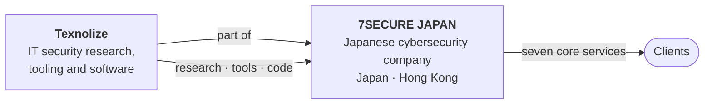
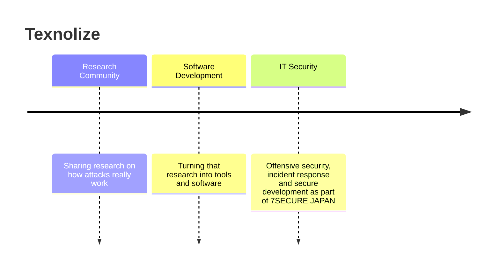

# 7SECURE JAPAN × Texnolize

**How the two names fit together**

---

## In one sentence

**7SECURE JAPAN** is a Japanese cybersecurity company delivering seven core services, focused on **Japan and Hong Kong**. **Texnolize** began as a research community, grew into a software development team, and now works on **IT security as part of 7SECURE JAPAN**.

 

## 🇯🇵 7SECURE JAPAN

A hacker-led cybersecurity company based in **Wakayama, Japan**, serving organisations in **Japan and Hong Kong**. 7SECURE JAPAN reopens to the public market on **15 November 2026**.

> We do not sell technology, AI, tools, or software. We sell technical expertise.

### Seven core services

| # | Service | What it covers |
|:-:|---|---|
| 01 | **Penetration Testing & Red Teaming** | Authorised attacks that show what an attacker could actually reach |
| 02 | **Digital Forensics & Incident Response** | Establishing what happened in an incident and proving it with evidence |
| 03 | **Cyber Investigations & Threat Intelligence** | Insider cases, fraud, impersonation and threat research |
| 04 | **Security Compliance & Risk Consulting** | Making control effectiveness demonstrable, not just documented |
| 05 | **Secure Digital Transformation** | Keeping security built in through cloud and technology change |
| 06 | **AI Adoption & Security Assessment** | Testing what AI systems are allowed to do, from an attacker's position |
| 07 | **Ransomware & Fraud Response** | Establishing the facts, containing harm and sequencing recovery |

🌐 **[7secure-japan.com](https://7secure-japan.com)** · **[7secure.jp](https://7secure.jp)**

 

## 🧪 Texnolize

Texnolize is a **professional hacker service**: it understands how attackers think and operate, and turns that into the capability to stop them.

### How Texnolize got here

| Stage | Focus |
|---|---|
| **1 · Research Community** | People studying attack patterns, techniques and behaviour, and sharing what they found |
| **2 · Software Development** | Turning that knowledge into working tools and software |
| **3 · IT Security** | Applying both to protect organisations, now **as part of 7SECURE JAPAN** |

🌐 **[texnolize.uk](https://texnolize.uk)** · [English](https://texnolize.uk/en/) · [日本語](https://texnolize.uk/ja/) · [Bahasa Indonesia](https://texnolize.uk/id/) · [中文](https://texnolize.uk/cn/)

 

## 🔗 How they work together

| | **7SECURE JAPAN** | **Texnolize** |
|---|---|---|
| **Role** | The cybersecurity company clients engage | The research and engineering team within it |
| **Focus** | Seven core services | IT security research, tooling and software |
| **Market** | Japan and Hong Kong | Supports 7SECURE JAPAN's engagements |
| **Origin** | Cybersecurity company | Research community → software development → IT security |

In practice, Texnolize's research, tools and code strengthen the services 7SECURE JAPAN delivers. Engagement material is shared privately with clients through this GitHub organisation, by invitation only.

 

## 📬 Contact

| | |
|---|---|
| 7SECURE JAPAN | [info@7secure-japan.com](mailto:info@7secure-japan.com) |
| Texnolize | [rui@texnolize.uk](mailto:rui@texnolize.uk) |

 
Texnolize Software · part of 7SECURE JAPAN

