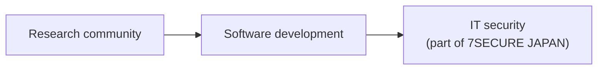

# 7SECURE JAPAN and Texnolize

Texnolize is part of 7SECURE JAPAN. This page explains who we are and how the two fit together.

## 7SECURE JAPAN

7SECURE JAPAN is a cybersecurity company based in Wakayama, Japan. Our work is focused on clients in Japan and Hong Kong.

We offer seven services:

1. Penetration Testing & Red Teaming
2. Digital Forensics & Incident Response
3. Cyber Investigations & Threat Intelligence
4. Security Compliance & Risk Consulting
5. Secure Digital Transformation
6. AI Adoption & Security Assessment
7. Ransomware & Fraud Response

We don't sell technology, AI, tools or software. What clients get from us is technical expertise.

Website: [7secure-japan.com](https://7secure-japan.com) (also [7secure.jp](https://7secure.jp))

## Texnolize

Texnolize started as a research community. The research led us into software development, and that work brought us to where we are now: IT security, as part of 7SECURE JAPAN.

Website: [texnolize.uk](https://texnolize.uk), in [English](https://texnolize.uk/en/), [日本語](https://texnolize.uk/ja/), [Bahasa Indonesia](https://texnolize.uk/id/) and [中文](https://texnolize.uk/cn/)

## How we work together

Clients work with 7SECURE JAPAN. Texnolize is one of the teams behind that work: we do research, build and maintain tools, and write the code used in testing and investigations.

When we share tools, code or reports with a client, they go into a private repository in this organisation. Only the people we invite can see it.

## Contact

- 7SECURE JAPAN: [info@7secure-japan.com](mailto:info@7secure-japan.com)
- Texnolize: [rui@texnolize.uk](mailto:rui@texnolize.uk)
